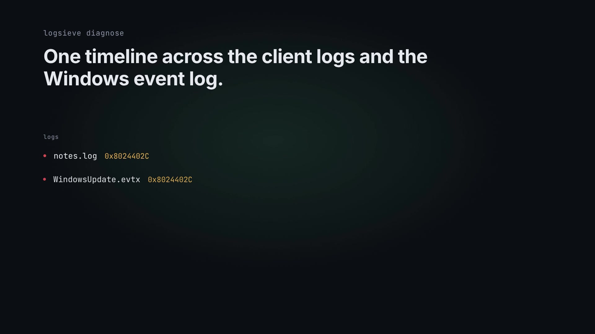

# logsieve

[](https://github.com/Abbasi26/logsieve/actions/workflows/test.yml)

Local diagnosis for ConfigMgr, Intune, and Windows event logs, with the identifiers removed before anything leaves the machine.

A client cannot install an update, and the useful lines are spread across `WUAHandler.log`, `AppEnforce.log`, `IntuneManagementExtension.log`, and a Windows Update event. Those lines also name the laptop, the user, and the WSUS server. logsieve puts the lines on one timeline, matches the codes it knows, and writes a report in which `laptop-07.northwind.example` has become `LS_HOST_2`. The mapping stays in an encrypted file on this computer. `logsieve reveal` puts a name back when you want to read an answer. A model is optional and off unless you ask.

## Demo video

[](docs/media/brag.mp4)

logsieve reads ConfigMgr, Intune and Windows event logs locally, replaces the identifiers with stable tokens, and writes the report with the error code and its source. `logsieve explain 0x8024402C` answers from the bundled library. No network, no model unless you ask for one. (Click the image to play the video.)

Music: Sascha Ende ([ende.app](https://ende.app)), licensed under [CC BY 4.0](https://creativecommons.org/licenses/by/4.0/).

## Quickstart

Python 3.11 or newer.

```bash
python -m venv .venv
source .venv/bin/activate
pip install -e ".[dev]"
logsieve demo
pytest
```

On Windows, activate with `.venv\Scripts\activate`. `logsieve demo` needs no network and no real logs. It writes `./logsieve-demo-out/` (the report, a generated `.evtx`, and a vault). That directory is the demo's explicit output. The command does not modify any endpoint.

This is the start of a real run:

```text
suspected cause: Windows Update cannot resolve the server name
pattern: wu-name-not-resolved  confidence: high
timeline:
  2026-10-21 08:01:05 UTC  error  notes.log  ERROR Windows Update failed with error 0x8024402C while contacting LS_HOST_1 from LS_HOST_2 at LS_IPV4_1.
  2026-10-21 08:01:40 UTC  error  collector.jsonl  lookup LS_HOST_1: no such host
reveal: The account was LS_EMAIL_1. -> The account was ada.example@northwind.example.
report leak check: clean
llm: off
```

The names in that reveal line are fictional (`northwind.example`, TEST-NET-3, the documentation IPv6 prefix). They are how the demo shows that reveal works.

## Diagnose a directory

```bash
logsieve diagnose C:\Windows\CCM\Logs I:\Intune\Logs --output C:\Temp\logsieve-out --vault C:\Temp\logsieve-vault.json
```

`--output` as a directory writes `report.md` and `report.html` (`--format all` adds `report.json`). A path ending in `.md`, `.html`, or `.json` writes that file. With no `--output`, Markdown goes to stdout.

The report has the error timeline, every matched pattern (confidence, whether it is uncertain, the public source, a redacted sample), a suspected cause, and checks. The cause is a ranking hint. Where one code is listed as a possible symptom of another, the report says so, and it says that the link is not proof. logsieve does not change the device.

By default the mapping is only in memory, and reveal cannot reconstruct it later. `--vault` writes the encrypted file. Without `LOGSIEVE_VAULT_PASSPHRASE`, the key is written to `<vault>.key` (mode `0600` on POSIX). With the variable set, the vault uses PBKDF2-HMAC-SHA256 and no key file. The passphrase is not accepted as a command-line flag.

```bash
logsieve reveal --vault C:\Temp\logsieve-vault.json --input answer.md
```

Reveal reads stdin when `--input` is omitted and writes stdout when `--output` is omitted.

Useful flags:

- `--keep-guids`, `--keep-ips`, `--no-redact`
- `--hostname NAME` and `--username NAME` (repeatable) for names that never appear in a parsed field
- `--parser auto|cmtrace|ime|evtx|event-xml|event-csv|journald|plain`
- `--pattern-dir DIR` for extra YAML
- `logsieve patterns` lists the built-in library (`--json` for scripts)

`--no-redact` leaves the text unchanged and refuses `--llm` and `--show-payload`.

## Look up a code without a log

```bash
logsieve explain 0x8024402C
logsieve explain -2016345060          # signed decimal from an IME log
logsieve explain "AppEnforce failed with 0x87D00324"
logsieve explain --json 0x80072EE7
```

`explain` reads only the local library. It prints the code in hex, signed, and unsigned form with the HRESULT facility, then every pattern that matches: the explanation, what to check, the public sources, and whether the meaning is marked uncertain. For a Win32 HRESULT (`0x8007xxxx`) it also tries the bare Win32 code. Exit code `1` means the library has no entry, which is not the same as "harmless".

## Machine-readable output

```bash
logsieve diagnose .\Logs --format json > diagnosis.json
logsieve diagnose .\Logs --format all --output .\out    # report.md, report.html, report.json
```

`report.json` (schema `1`) holds the suspected cause, every finding with samples and sources, the next steps, and the redacted error timeline. It is built from the same redacted fields as the other reports and goes through the same leak check, so a ticket system or SIEM can ingest it without the original names.

## Add your own patterns

```bash
logsieve patterns --check .\my-patterns
logsieve diagnose .\Logs --pattern-dir .\my-patterns
```

`--check` loads every YAML file, then reports ids that collide with each other or the built-in library, sources that are not `https://`, empty explanations, and `self_test` lines that are missing or do not match. It exits `1` when something is wrong, so it fits in a CI step. Without a path it checks the built-in library.

## A model, still local

Nothing is sent unless you pass `--llm`. The default URL is `http://127.0.0.1:11434/v1` (Ollama's OpenAI-compatible API) and the default model is `llama3.2`. Any `/chat/completions` URL works. `LOGSIEVE_LLM_API_KEY` is sent as a bearer token when set.

```bash
logsieve diagnose .\Logs --show-payload > payload.json
logsieve diagnose .\Logs --llm --llm-model llama3.2 --vault .\logsieve-vault.json --output .\out
```

`--show-payload` prints the JSON body and does not open a socket. That body is built from the redacted diagnosis and the redacted error lines. logsieve checks that the original identifiers are absent. If one remains, it refuses, does not print the identifier, and exits 2.

Exit codes: `0` success, `1` bad input or no events, `2` refused to write or send, `3` the model request failed and the report was still written. Argument errors also use `2`.

## What it reads

| Input | How |
| --- | --- |
| CMTrace / ConfigMgr (`<![LOG[... ]LOG]!>`), including UTF-16 | parsed, severity from the type attribute |
| `IntuneManagementExtension.log`, `AgentExecutor.log`, and the other IME names | same grammar, labeled `ime` |
| `.evtx` | [python-evtx](https://github.com/williballenthin/python-evtx) |
| Exported event XML and event CSV | namespace-agnostic XML, header aliases for CSV |
| journald JSON lines | `MESSAGE`, `PRIORITY`, `__REALTIME_TIMESTAMP` or an ISO `timestamp` |
| Anything else text | one line, one event, ISO timestamps when present |

Files are only read. A directory is walked and report, vault, and key files are skipped so a second run does not ingest its own output.

## Permissions

logsieve needs read access to the files you pass. It does not need an administrator token unless the file ACL does. The live logs under `%SystemRoot%\System32\winevt\Logs` are a common case that does. The tool does not subscribe to a channel and does not call `wevtutil`.

## Tests

`pytest` covers the parsers, a pseudonymization round trip (the original identifiers must not appear in the model payload), the pattern self-tests, and the demo. No test contacts the network. GitHub Actions runs the same suite on Python 3.11, 3.12, and 3.13, checks the pattern library with `logsieve patterns --check`, and runs the demo, `explain`, and the JSON report as a smoke test.

## Contributing

See [CONTRIBUTING.md](CONTRIBUTING.md). A new error code needs a public source URL, a fictional `self_test` line, and `uncertain: true` when the source is ambiguous.

## Roadmap

[ROADMAP.md](ROADMAP.md) lists what comes next and a set of good first issues.

Not in this version, and not claimed:

- A live event channel, ETW, or a tail of a growing log.
- Bare `samAccountName` values that never show up in a path, an email, a `DOMAIN\user` pair, or a user field.
- Wrapping [Presidio](https://github.com/data-privacy-stack/presidio). The recognizers here are written for this log set.
- A complete HRESULT catalogue. The YAML library is a subset. A miss means the code is not in the file.
- A scored set of "bad model advice" to regress against.
- A GUI, or any action that changes the endpoint.
- IME logs that are not CMTrace, except where they are already plain text or JSON.
- A memory-hard key derivation. The passphrase path is PBKDF2.

## How this differs

[Presidio](https://github.com/data-privacy-stack/presidio) is a library for reversible pseudonymization (encrypt and decrypt operators, `DeanonymizeEngine`). It does not ship recognizers for this mix of hostnames, SIDs, UPNs, and CMTrace paths, and it does not diagnose a client.

[k8sgpt](https://github.com/k8sgpt-ai/k8sgpt) can anonymize and talk to Ollama, and it is aimed at Kubernetes. Its own privacy notes say events are not masked ([privacy guidelines](https://docs.k8sgpt.ai/reference/guidelines/privacy/)).

[HolmesGPT](https://github.com/HolmesGPT/holmesgpt) is a cloud-native troubleshooting agent with an Ollama provider. It does not target Windows or ConfigMgr client logs, and reversible pseudonymization is not part of the product.

[CMTrace Open](https://github.com/adamgell/cmtraceopen) displays ConfigMgr, IME, and Autopilot logs and can highlight known lines. It is a viewer. logsieve does not replace it. This project adds a single timeline across those logs and the Windows event log, reversible tokens, and an optional explanation of the redacted text.

## Status

Version 0.2.0, early but usable. Python package `logsieve`. MIT licensed. Every push runs the test suite in GitHub Actions (`.github/workflows/test.yml`).

## Install

```sh
pip install .
```

## License

MIT. Copyright (c) 2026 Wasaf Abbasi.

## Kurzfassung

logsieve ist ein lokales Kommandozeilenwerkzeug für Windows-Endgeräte. Es liest ConfigMgr/CMTrace-Logs, Logs der Intune Management Extension und Windows-Ereignisse, setzt sie auf eine Zeitlinie und ersetzt Hostnamen, Konten, SIDs, Adressen, GUIDs und Profilpfade durch stabile Tokens. Die Zuordnung liegt verschlüsselt nur auf diesem Rechner. `logsieve reveal` setzt die Tokens in einer Antwort wieder ein. Bekannte Fehlercodes aus MECM, Intune und Windows Update werden mit Quelle und Prüfvorschlägen erklärt. Ein Sprachmodell ist standardmäßig aus und bekommt nur den bereits ersetzten Text. `logsieve demo` läuft ohne Netz und ohne echte Kundendaten. Das Werkzeug ändert den Endpoint nicht.